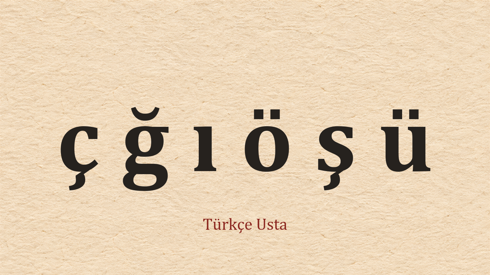
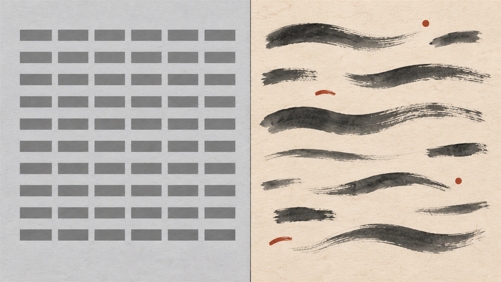

<p align="center">
  
</p>

# Türkçe Usta

Yapay zekâ modelleri Türkçeyi çoğu zaman İngilizce düşünüp yazar: "önemli bir rol oynamaktadır", "etkili bir şekilde", "Günümüzün hızla değişen dünyasında"... Türkçe Usta, bu çeviri iskeletini söküp metni Türkçenin kendi sözdizimine, ek sistemine ve güncel TDK yazım kurallarına taşıyan bir **agent skill** paketidir. Claude Code, claude.ai, Codex ve Gemini CLI ile çalışır.

Skill kendiliğinden devreye girmez. `/turkce-usta` yazdığınızda ya da açıkça Türkçe yazım ve düzeltme desteği istediğinizde açılır.

<p align="center">
  <a href="https://github.com/yigityildiz0/turkce-usta/releases/latest/download/turkce-usta.zip">
    
  </a>
</p>

<p align="center"><a href="https://github.com/yigityildiz0/turkce-usta/releases/latest/download/turkce-usta.zip"><b>turkce-usta.zip dosyasını indir (son sürüm)</b></a></p>

## Ne sağlar

- **TDK imla ve noktalama.** Kesme işareti ve ekler (`TDK'ye`, `URL'yi`, `GitHub'da`, `Türk Dil Kurumuna`), ayrı yazılan `de/da`, `ki` ve `mi`, noktalı saat (`14.30`), sayı ve yüzde biçimi (`1.250,75 TL`, `%25`), düzeltme işareti (`hâlâ/hala`, `resmî`), başlıklarda bağlaçların küçük yazılması. Uzun tire (`—`) ara sözde kullanılmaz.
- **Türkçe cümle mimarisi.** Niteleyici sıfat-fiille ismin önüne alınır, vurgulanan bilgi yüklemin hemen önüne yerleşir, ardışık eylemler ulaçlarla (`-Ip`, `-ArAk`, `-IncA`) bağlanır. "Bir sistem kurduk, bu sistem..." türü İngilizce iskelet kurulmaz.
- **Bağlaç ve ek çeşitliliği.** `ancak, ayrıca, dolayısıyla` refleksi yerine nüansa göre seçim (*oysa, hâlbuki, nitekim, zira, meğer, gelgelelim, kaldı ki, diye*). Kanıtsal `-mIş`, `-(y)Iver`, işteş çatı, `m-p-r-s` pekiştirmesi (*bembeyaz, sapasağlam*) gibi Türkçenin kendi araçları kullanılır; `-mAktAdIr` yığını çözülür.
- **Yapay zekâ kalıbı temizliği.** "Günümüzün hızla değişen dünyasında", "sadece X değil, aynı zamanda Y", "Önemle belirtmek gerekir ki", "Sonuç olarak şunu söyleyebiliriz ki", "rol oynamak / sahip olmak / gerçekleştirmek" gibi kof fiiller, mekanik üçlemeler ve slogan kapanışları ayıklanır.
- **Olgu kilidi.** Metin onarılırken kaynakta olmayan sayı, tarih, kişi, kurum ya da neden-sonuç bağı eklenmez. Somut veri gerekiyorsa `[somut veri: ...]` yer tutucusu bırakılır.
- **Sicil ayarı.** Sohbet, blog, teknik, kurumsal e-posta, akademik, resmî/hukuki, edebî ve arayüz metni için ayrı ölçüler. Resmî yazışma için Resmî Yazışma Yönetmeliği ve CK 2646 biçimleri; hukuk metninde mevzuat yazımı (*re'sen, zamanaşımı*) ile genel TDK yazımının (*resen, zaman aşımı*) aynı belgede karışmaması.
- **Aşırı düzeltme freni.** Yaşayan yabancı kökenli sözcükler (*sistem, performans, detay*) zorla öz Türkçeye çevrilmez. Kullanıcının kendi yazısından örnek varsa onun sesi en üst kural sayılır.
- **Dört çalışma modu.** `yaz` (sıfırdan üretim), `duzelt` (varsayılan onarım), `denetle` (yeniden yazmadan P0/P1/P2 bulgu listesi), `imla` (düzeltilmiş metin ve `Yanlış -> Doğru -> Kural` tablosu).
- **Yerel denetim betiği.** `scripts/denetle.py`, yalnız Python standart kütüphanesiyle çalışır; ağ bağlantısı ya da dış paket istemez.

Ayrıntılar yedi başvuru dosyasında durur: sözdizimi, ekler ve kipler, bağlaçlar, duygu ve anlatım, TDK imla ve terim, yapay zekâ kalıbı temizliği, sicil profilleri. Model yalnız işin gerektirdiği dosyayı açar.

## Normal model ne yazıyor, Türkçe Usta ile ne yazıyor

<p align="center">
  
</p>

Aşağıdaki örneklerin hepsi testteki gerçek çıktılardır; tek harfine dokunulmadan alıntılandı. "Skill'siz" sütunu aynı modelin aynı istemi skill yüklenmeden yanıtladığı hâldir.

### 1. Kalıp temizliği: Gemini 3.8 Flash (High), madde e

Puan 3,92'den 4,75'e çıktı; `denetle.py` bulgusu 3'ten 1'e indi.

| Skill'siz | Türkçe Usta ile |
|---|---|
| Düzenli egzersiz, sağlıklı bir yaşam için büyük önem taşır. Yalnızca fiziksel sağlığı iyileştirmekle kalmaz, zihinsel sağlığa da katkıda bulunur. Yürüyüş, yüzme ve bisiklet gibi aktiviteler hem etkili hem de kolay erişilebilir ve sürdürülebilir seçeneklerdir. Uzmanlar, haftada en az 150 dakika orta yoğunlukta egzersiz yapılmasını öneriyor. Bu doğrultuda egzersiz, hayatımızın bir parçası hâline gelmelidir. | Sağlıklı bir yaşam için düzenli egzersiz şart. Egzersiz, fiziksel sağlığı iyileştirdiği gibi zihinsel sağlığı da destekler. Yürüyüş, yüzme ve bisiklet gibi aktiviteler hem kolay erişilebilen hem de etkili ve sürdürülebilir seçeneklerdir. Uzmanlar haftada en az 150 dakika orta yoğunlukta egzersiz öneriyor. Kısacası egzersizi hayatımızın vazgeçilmez bir parçası hâline getirmek gerekir. |

"büyük önem taşır", "Yalnızca ... kalmaz" ve "Bu doğrultuda" gitti; bilgilerin hepsi yerinde kaldı.

### 2. Çeviri kokusu: Gemini 3.8 Flash (High), madde c

Puan 3,33'ten 4,58'e çıktı.

| Skill'siz | Türkçe Usta ile |
|---|---|
| Bu yeni özellik, kullanıcıların kendi verilerini daha etkili bir şekilde yönetebilmesinde önemli bir rol oynuyor. | Bu yeni özellik, kullanıcıların verilerini daha etkili yönetmesini sağlar. |

Bedeli de var: "önemli" ve "kendi" düştü, görev uyumu 3,33'te kaldı.

### 3. Akademik cümle: Gemini 3.8 Flash (High), madde h

Puan 3,42'den 4,33'e çıktı.

| Skill'siz | Türkçe Usta ile |
|---|---|
| Katılımcılara uygulanan anket sonuçlarının analizi, egzersiz sıklığındaki artışın uyku kalitesi üzerinde olumlu bir etkiye sahip olduğunu ve bu durumun yaş grupları arasında farklılık gösterdiğini ortaya koymuştur. Elde edilen bu bulgu literatür ile uyumluluk göstermektedir. | Katılımcılara uygulanan anket sonuçlarının analizi sonucunda, egzersiz sıklığındaki artışın uyku kalitesini olumlu etkilediği tespit edilmiştir. Yaş grupları arasında farklılık gösterdiği de gözlenen bu bulgu, literatürle örtüşmektedir. |

### 4. Kısaltma eki: GPT-6.1 Sol, madde a

Puan 4,5'ten 4,75'e çıktı.

| Skill'siz | Türkçe Usta ile |
|---|---|
| Sen de yarınki toplantıya gelecek misin, yoksa raporu TDK'ya göre düzeltip saat 14.30'da Ayşe'ye gönderdikten sonra eve mi gideceksin? Çünkü ben de bilmiyorum ki kimler gelecek. | Sen de yarınki toplantıya gelecek misin, yoksa raporu TDK'ye göre düzeltip saat 14.30'da Ayşe'ye gönderdikten sonra eve mi gideceksin? Çünkü ben de bilmiyorum ki kimler gelecek. |

Kısaltma, okunuşuna göre ek alır: "Te-De-Ke" okunduğu için `TDK'ye`. Altı modelden dördü skill'siz koşulda da bunu doğru yaptı; GPT-6.1 Sol ve Claude Sonnet 5.5 skill'siz hâlde `TDK'ya`yı olduğu gibi bıraktı.

### 5. Samimi mesaj: Claude Opus 5.5, madde b

Puan 4,17'den 4,83'e çıktı.

| Skill'siz | Türkçe Usta ile |
|---|---|
| Selam! Trafik felaket, yemeğe yarım saat kadar geç kalacağım galiba 😕 Siz masayı tutun, siparişe de başlayın, ben gelince yetişirim. Kusura bakmayın! | Selam, trafik felaket, yemeğe yarım saat kadar geç kalacağım. Masayı tutun, beni beklemeden siparişe başlayın, ben de yetişirim. |

"galiba" belirsizliği, noktalamasız emoji geçişi ve istenmeyen özür gitti.

### 6. Teknik anlatım: Gemini 4 Hydrogen (High), madde g

Puan 4,42'den 4,83'e çıktı. Skill'siz çıktının son cümlesi şöyleydi:

> İşte bu yüzden "önbelleği temizleyin" denildiğinde amaç, saklanan eski dosyaları silerek tarayıcıyı sitenin en güncel sürümünü yeniden indirmeye yönlendirmektir.

Skill'li çıktıdan:

> Ne var ki site güncellendiğinde tarayıcı bazen yenisini getirmek yerine sakladığı eski kopyayı göstermekte ısrar edebilir; kimi zaman da bozuk kaydedilmiş bir dosya sayfanın hatalı çalışmasına yol açar. Bu yüzden sorun yaşandığında sizden "Önbelleği temizleyin" diye istenir.

## Testlerim ve sonuçlar

Skill'in gerçekten bir şey değiştirip değiştirmediğini görmek için her modeli aynı sekiz görevle, skill'li ve skill'siz olarak iki kez çalıştırdım. Çıktıları kimliklerini gizleyerek puanlattım. Bütün çıktılar, puanlar ve puanlayıcı gerekçeleri [`testler/`](testler) klasöründe.

### Test cümleleri

| # | Tür | Görev | Girdi |
|---|---|---|---|
| a | Basit | Yazım ve noktalama hatalarını TDK'ye göre düzelt; anlamı ve cümle yapısını koru. | Sende yarınki toplantıya gelecekmisin, yoksa raporu TDK'ya göre düzeltip saat 14:30'da Ayşeye gönderdikten sonra eve mi gideceksin, çünkü bende bilmiyorumki kimler gelecek. |
| b | Basit | Arkadaşa WhatsApp mesajı: akşam yemeğine yaklaşık 30 dakika gecikeceksin, trafik çok yoğun, masayı tutmalarını ve siparişe başlamalarını istiyorsun. Doğal, samimi, tek mesaj. | (girdi yok) |
| c | Basit | İngilizceden çevrilmiş gibi duran cümleyi anlamını koruyarak doğal Türkçeyle yeniden yaz. | Bu yeni özellik, kullanıcıların kendi verilerini daha etkili bir şekilde yönetmelerine olanak sağlayarak önemli bir rol oynamaktadır. |
| d | Basit | E-ticaret için 2-3 cümlelik ürün açıklaması: paslanmaz çelik termos, 500 ml, sıcağı 12, soğuğu 24 saat korur, bulaşık makinesinde yıkanabilir. Özellik uydurma. | (girdi yok) |
| e | Karmaşık | Paragrafı yapay zekâ kalıplarından arındır; bilgi ekleme, bilgi silme. | Günümüzün hızla değişen dünyasında, düzenli egzersiz yapmak sağlıklı bir yaşam için büyük bir önem taşımaktadır. Önemle belirtmek gerekir ki, egzersiz sadece fiziksel sağlığı iyileştirmekle kalmaz, aynı zamanda zihinsel sağlığa da katkı sağlamaktadır. Bu bağlamda yürüyüş, yüzme ve bisiklet gibi aktiviteler etkili, erişilebilir ve sürdürülebilir seçenekler olarak öne çıkmaktadır. Uzmanlara göre haftada en az 150 dakika orta yoğunlukta egzersiz yapılması önerilmektedir. Sonuç olarak şunu söyleyebiliriz ki, egzersiz hayatımızın vazgeçilmez bir parçası olmalıdır. |
| f | Karmaşık | Belediyeye resmî dilekçe: sokak lambası üç haftadır yanmıyor, akşamları yol karanlık, yayalar için tehlikeli; onarılsın. Ad, adres, belediye ve tarih için köşeli ayraçlı yer tutucu. | (girdi yok) |
| g | Karmaşık | Tarayıcı önbelleğinin (cache) ne olduğunu ve neden "önbelleği temizleyin" dendiğini teknik bilgisi olmayan okura 4-5 cümlelik tek paragrafta anlat. | (girdi yok) |
| h | Karmaşık | Edilgen yığınlı akademik cümleyi doğal akademik Türkçeye çevir; anlamı ve kesinlik derecesini koru. | Katılımcılara uygulanan anket sonuçlarının analiz edilmesi sonucunda, egzersiz sıklığının artırılmasının uyku kalitesi üzerinde olumlu bir etkiye sahip olduğu tespit edilmiş olup, bu durumun yaş grupları arasında farklılık gösterdiği de ayrıca gözlemlenmiştir ki bu bulgu literatür ile uyumluluk göstermektedir. |

### Yöntem

- **Modeller:** Claude Opus 5.5 ve Claude Sonnet 5.5 (Antigravity üzerinden), GPT-6.1 Sol ve GPT-6.1 Terra (Codex CLI), Gemini 4 Hydrogen (High) ve Gemini 3.8 Flash (High) (Antigravity).
- **Koşullar:** *Temel*, yani skill yüklenmeden yalnız görev talimatı; *Skill*, yani aynı talimat ve Türkçe Usta. Her model her koşulda tek çağrı, her madde tek örnek: 6 model × 2 koşul × 8 madde = 96 çıktı.
- **Kör puanlama:** Çıktılar model ve koşul bilgisi gizlenip karıştırıldı (Y001-Y096). Üç bağımsız puanlayıcı (üçü de Claude Sonnet 5.5, yüksek efor) çıktıları farklı sıralarla (düz, ters, tek-çift) puanladı. Her çıktı dört ölçütte 1-5 arası puan aldı: TDK imla ve noktalama, doğallık, görev uyumu, akıcılık. Bir çıktının puanı üç puanlayıcının ortalamasıdır. Kimlik eşlemesi puanlama bittikten sonra açıldı.
- **Puanlayıcı uyumu:** Üç puanlayıcının çıktı puanları arasındaki Pearson korelasyonu 0,78 ile 0,86 arasında.
- **`denetle.py`:** Her çıktı puanlamadan önce bu betikle de tarandı (sicil: a ve b sohbet; c, d, e ve g blog; f resmî; h teknik). Bulgular puanlayıcıya ipucu olarak verildi.

### Sonuçlar

**Model başına ortalama puan (1-5)**

| Model | Skill'siz | Skill ile | Fark | Madde: daha iyi / eşit / daha kötü | `denetle.py` bulgusu (skill'siz / skill ile) |
|---|---|---|---|---|---|
| Gemini 4 Hydrogen (High) | 4,10 | 4,58 | **+0,48** | 8 / 0 / 0 | 4 / 2 |
| Gemini 3.8 Flash (High) | 3,81 | 4,09 | **+0,28** | 4 / 1 / 3 | 5 / 3 |
| GPT-6.1 Sol | 4,57 | 4,65 | +0,07 | 5 / 0 / 3 | 4 / 3 |
| GPT-6.1 Terra | 4,62 | 4,67 | +0,04 | 3 / 3 / 2 | 1 / 1 |
| Claude Sonnet 5.5 | 4,39 | 4,41 | +0,02 | 4 / 0 / 4 | 1 / 1 |
| Claude Opus 5.5 | 4,67 | 4,52 | **-0,15** | 1 / 3 / 4 | 3 / 1 |
| **Altı model toplu** | **4,36** | **4,49** | **+0,13** | | **18 / 11** |

**Ölçüt başına (altı model toplu)**

| Ölçüt | Skill'siz | Skill ile |
|---|---|---|
| TDK imla ve noktalama | 4,74 | 4,74 |
| Doğallık | 4,07 | 4,41 |
| Görev uyumu | 4,38 | 4,37 |
| Akıcılık | 4,26 | 4,42 |

**Madde başına (altı model ortalaması)**

| Madde | a | b | c | d | e | f | g | h |
|---|---|---|---|---|---|---|---|---|
| Skill'siz | 4,29 | 4,49 | 4,19 | 4,61 | 4,14 | 4,24 | 4,56 | 4,38 |
| Skill ile | 4,35 | 4,72 | 4,49 | 4,69 | 4,21 | 4,40 | 4,38 | 4,65 |

Basit maddelerde (a-d) ortalama 4,40'tan 4,56'ya, karmaşık maddelerde (e-h) 4,33'ten 4,41'e çıktı.

**Kısaca:** Kazanç imlada değil, doğallık ve akıcılıkta. Etki modele göre çok değişiyor:

- **Gemini'de belirgin.** Gemini 4 Hydrogen sekiz maddenin sekizinde iyileşti (+0,48); Gemini 3.8 Flash'ta doğallık 3,21'den 3,96'ya çıktı.
- **GPT'de gürültü düzeyinde** (+0,04 ile +0,07). GPT'nin temel koşulu zaten benzer kuralları içeren bir talimat dosyasıyla çalıştı (aşağıya bakın).
- **Claude'da etkisiz ya da ters.** Claude Sonnet 5.5'te fark yok (+0,02). Claude Opus 5.5 skill'siz hâlde zaten en yüksek puanı aldı (4,67) ve skill ile düştü (-0,15). Düşüşün ana kaynağı görev uyumu (4,58'den 4,21'e): skill'li Opus uzunluk sınırını aştı ve bir cümlenin mantığını kaydırdı (ayrıntı aşağıda).

Tek örnekle 0,3 puanın altındaki farklar gürültüden ayırt edilemez. Bu sonuçla Türkçe Usta'yı en çok zayıf ya da orta düzey Türkçe yazan modellerde kullanmanızı, Claude Opus 5.5 gibi güçlü bir modelde ise uzunluk ve biçim talimatlarını açıkça yinelemenizi öneririm.

### Dürüst notlar

- **GPT modellerinde temel koşul temiz değil.** Codex, test makinesindeki genel talimat dosyasını (`~/.codex/AGENTS.md`) iki koşulda da yükledi. Bu dosya zaten "doğal Türkçe yaz" türü kurallar içeriyordu. Dolayısıyla GPT-6.1 Sol ve GPT-6.1 Terra için "skill'siz" çıktı çıplak model değil, talimatlı modeldir; skill'in GPT'deki katkısını alt sınır sayın.
- **Claude ve Gemini modellerinde temel koşul kısmen temiz.** Antigravity, iki koşulda da kısa bir genel talimat dosyasını (`~/.gemini/GEMINI.md`, "Türkçe, kısa, doğal yaz" satırı dahil) yükledi.
- **Claude Haiku 5.5 ölçülemedi.** Antigravity'nin model listesinde yok; başka temiz bir çağrı yolu da bulunamadı.
- **Puanlayıcılar Claude ailesinden.** Üç puanlayıcı da Claude Sonnet 5.5; Claude çıktılarına karşı bir yanlılık ihtimali var. Kimlik gizli olduğu için bu yanlılık skill'li ve skill'siz koşulu eşit etkiler.
- **Madde a iki kez puanlandı.** İlk puanlama brief'inde benim hatam vardı: `TDK'ya` biçimini doğru diye yazmıştım. Madde a'nın 12 çıktısı düzeltilmiş brief'le yeniden puanlandı. Yeniden puanlamada da `TDK'ya` hatasını bırakan iki çıktıda puanlayıcıların çoğu hatayı kaçırdı; bu iki çıktıda imla puanını elle, hatayı yakalayan puanlayıcının verdiği 4'e indirdim. İlk ve yeniden puanlamanın ham puanları [`testler/`](testler) klasöründe duruyor.
- **İstatistiksel güç düşük.** Model ve koşul başına tek koşu, madde başına tek örnek.

### Skill'in zayıf kaldığı yerler

- **Uzunluk sınırını aşma.** Madde g "4-5 cümle" istiyordu. Skill'li Claude Opus 5.5 yedi, skill'li Claude Sonnet 5.5 altı cümle yazdı; ikisinin skill'siz çıktısı beş cümleydi. Opus'un görev uyumu bu maddede 5'ten 2,33'e düştü. Muhtemel neden skill'in ritim kuralı: uzun cümleleri kısa, net ifadelerle harmanlama yönergesi cümleleri bölmeye itiyor ve açık cümle sayısı sınırını ezebiliyor. Bir sonraki sürümde "kullanıcının verdiği uzunluk sınırı ritim kuralından önce gelir" kuralı eklenecek; bu test, kuralın eklenmediği v2.2.0 ile yapıldı.
- **Bilgi kaybı.** Sadeleştirirken kaynaktaki bazı öğeler düştü: "önemli" ve "kendi" (madde c; Gemini 3.8 Flash, Claude Sonnet 5.5), "Uzmanlar" atfı (GPT-6.1 Sol, madde e). Görev uyumu dört modelde skill ile düştü: Claude Opus 5.5 4,58'den 4,21'e, GPT-6.1 Sol 4,58'den 4,29'a, Claude Sonnet 5.5 4,42'den 4,29'a, GPT-6.1 Terra 4,58'den 4,50'ye.
- **Anlam kayması.** Claude Opus 5.5 madde c'de "Bu yeni özellik önemli, çünkü kullanıcılar verilerini onun sayesinde daha etkili yönetebiliyor." yazdı; neden-sonuç sırası değişti ve "kendi" düştü (4,58'den 4,08'e).
- **Soru işareti kaybı.** Claude Sonnet 5.5 madde a'da skill ile `TDK'ye` düzeltmesini yaptı ama soru cümlesini noktayla bitirdi (5'ten 4,08'e).
- **Noktalı virgül hatası.** Gemini 3.8 Flash skill'li çıktıda özne ile yüklemin arasına noktalı virgül koydu: "500 ml kapasiteli bu paslanmaz çelik termos; sıcak içecekleri..." (madde d) ve "Tarayıcı önbelleği; ziyaret ettiğiniz..." (madde g).
- **Etkisiz kaldığı yer.** Gemini 3.8 Flash, madde a'da iki koşulda da aynı çıktıyı verdi ve girdideki doğru virgülleri sildi.
- **`denetle.py` sınırları.** Büyük harfli kısaltma kuralı (`TDK'ya`) metin küçük harfe çevrildikten sonra büyük harf deseniyle arandığı için hiç tetiklenmiyor. Teknik sicilde `-mIştIr/-mAktAdIr` uyarısı akademik metinde yanlış alarm veriyor. Betik girdideki hatalara bakmaz, yalnız çıktıyı tarar. Test sırasında Windows'ta standart girdiden (`-`) okurken Türkçe harfleri bozan bir hata da bulundu ve bu sürümde düzeltildi.

## Kurulum

Önce paketi indirin: **[turkce-usta.zip](https://github.com/yigityildiz0/turkce-usta/releases/latest/download/turkce-usta.zip)**. Arşivin içinde `turkce-usta/` klasörü vardır (`SKILL.md`, `references/`, `scripts/`, `LICENSE`).

### Claude Code

macOS / Linux:

```bash
curl -L -o turkce-usta.zip https://github.com/yigityildiz0/turkce-usta/releases/latest/download/turkce-usta.zip
mkdir -p ~/.claude/skills
unzip -o turkce-usta.zip -d ~/.claude/skills
```

Windows (PowerShell):

```powershell
Invoke-WebRequest https://github.com/yigityildiz0/turkce-usta/releases/latest/download/turkce-usta.zip -OutFile turkce-usta.zip
Expand-Archive turkce-usta.zip -DestinationPath "$HOME\.claude\skills" -Force
```

Sonuçta `~/.claude/skills/turkce-usta/SKILL.md` yolu oluşmalı. Claude Code'u yeniden başlatın ve `/turkce-usta` yazın.

### Codex

Aynı arşivi `~/.codex/skills/` altına açın:

```bash
mkdir -p ~/.codex/skills
unzip -o turkce-usta.zip -d ~/.codex/skills
```

Windows'ta hedef klasör `"$HOME\.codex\skills"` olur. Codex'i yeniden başlatın; isteğinizde skill'in adını (`turkce-usta`) anın.

### Gemini CLI ve Antigravity

Gemini CLI, depoyu doğrudan kurabilir:

```bash
gemini skills install https://github.com/yigityildiz0/turkce-usta
```

Ya da arşivi `~/.gemini/skills/` (veya ortak `~/.agents/skills/`) altına açın. Açık bir oturumda `/skills reload` komutuyla listeyi yenileyin.

Antigravity için `turkce-usta` klasörünü kullandığınız sürümün skill dizinine kopyalayın (çoğu kurulumda ortak `~/.agents/skills/`). Klasör adı `turkce-usta` olarak kalmalı.

### claude.ai

1. `turkce-usta.zip` dosyasını indirin, açmayın.
2. **Ayarlar → Yetenekler (Capabilities) → Skills** bölümünde **Yükle**'ye tıklayın ve zip dosyasını seçin.
3. Sohbette `/turkce-usta` yazın ya da Türkçe düzeltme isteyin.

## Kullanım

```text
/turkce-usta duzelt: Bu yeni özellik, kullanıcıların kendi verilerini daha etkili bir şekilde yönetmelerine olanak sağlayarak önemli bir rol oynamaktadır.
```

```text
/turkce-usta yaz: Belediyeye sokak lambası arızası için resmî bir dilekçe. Ad, adres ve tarih yer tutucu olsun.
```

```text
/turkce-usta denetle: (metninizi buraya yapıştırın)
```

```text
/turkce-usta imla: Sende yarınki toplantıya gelecekmisin?
```

Mod belirtmezseniz skill varsayılan olarak `duzelt` modunda çalışır ve yalnız temizlenmiş metni verir.

Yerel denetim betiği, Python 3 yüklü her makinede çalışır:

```bash
python -B scripts/denetle.py metin.md --register blog
python -B scripts/denetle.py metin.md --register resmi --json
```

Sicil seçenekleri: `sohbet`, `blog`, `teknik`, `kurumsal`, `resmi`, `edebi`, `ux`.

## Lisans

[MIT](LICENSE) © 2026 Yiğit Yıldız
